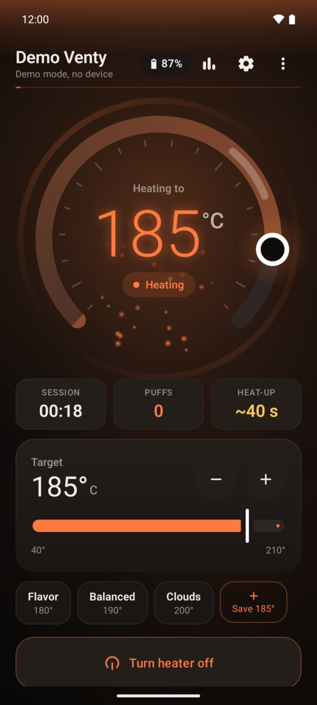
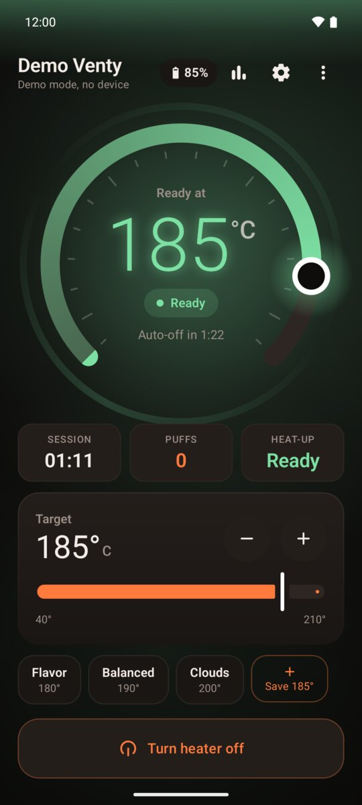
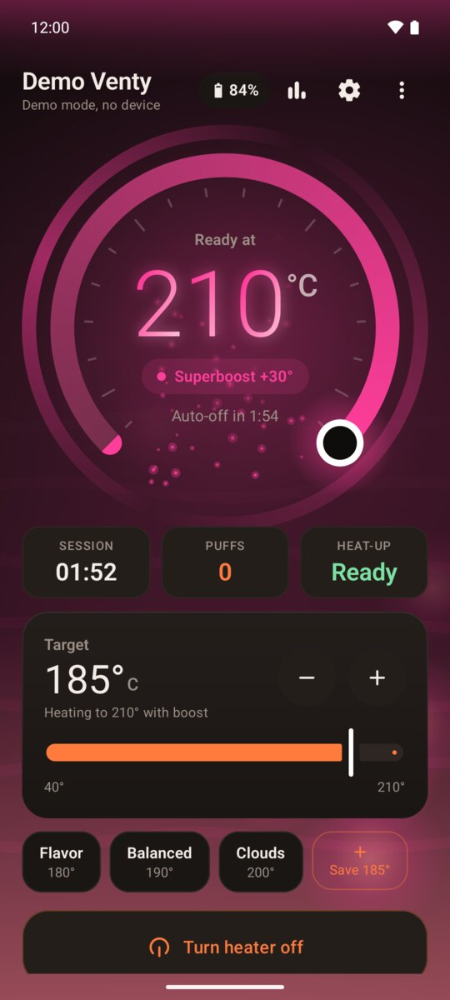
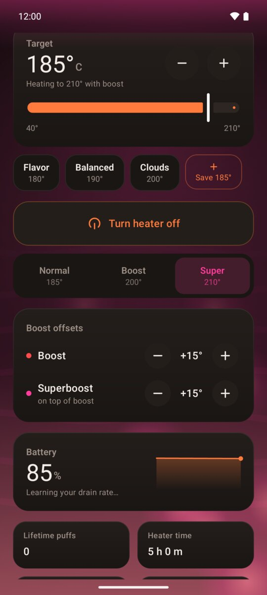
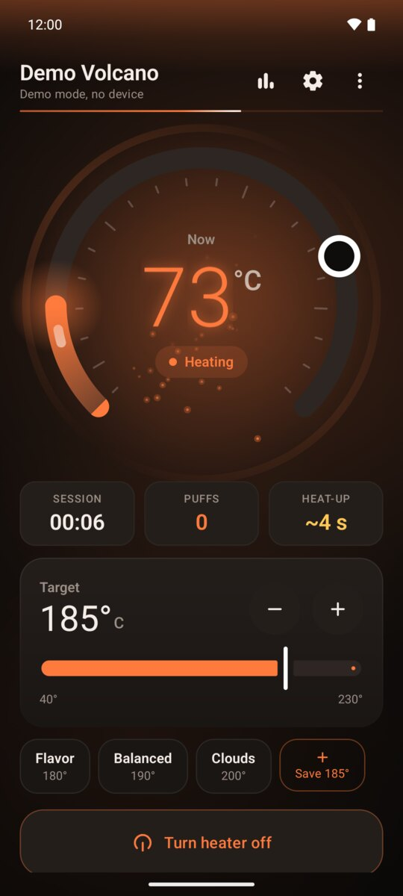
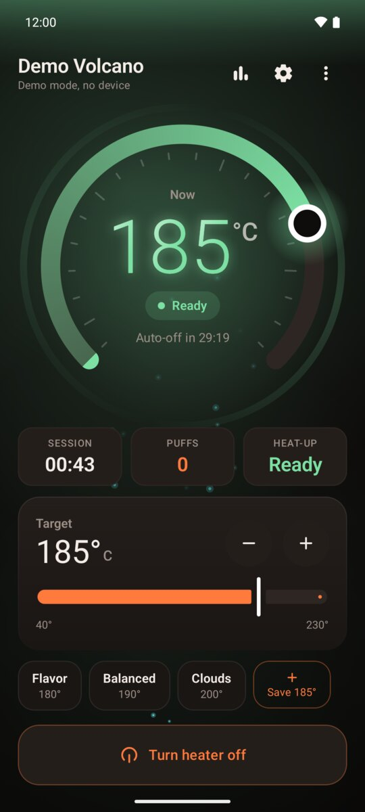
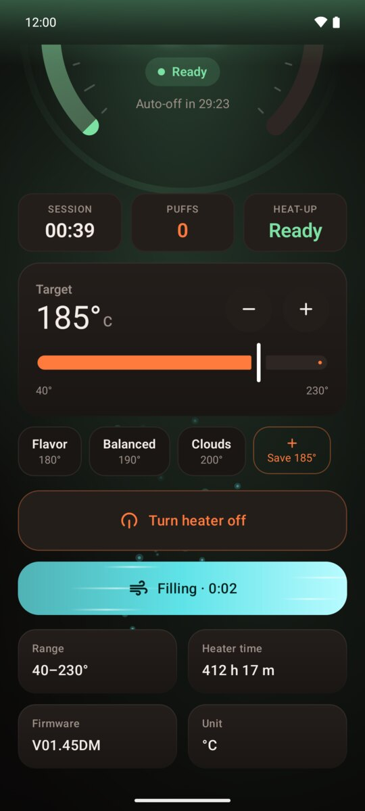
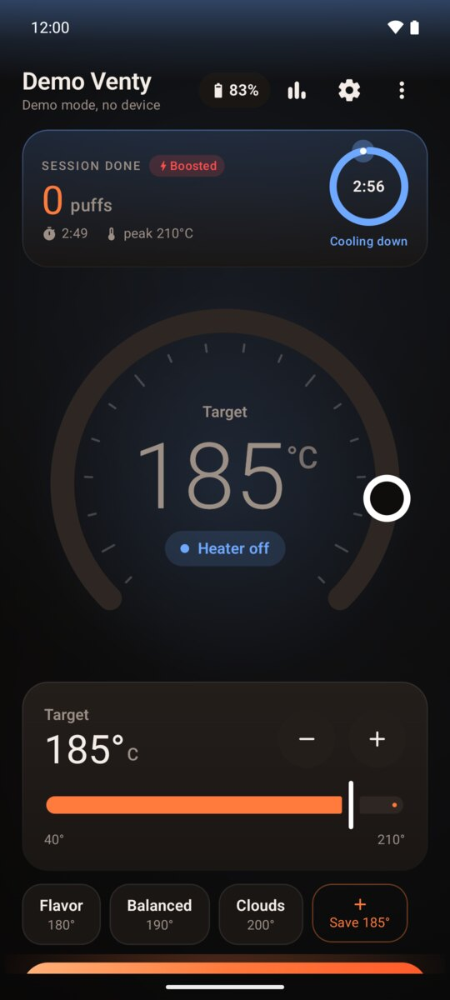
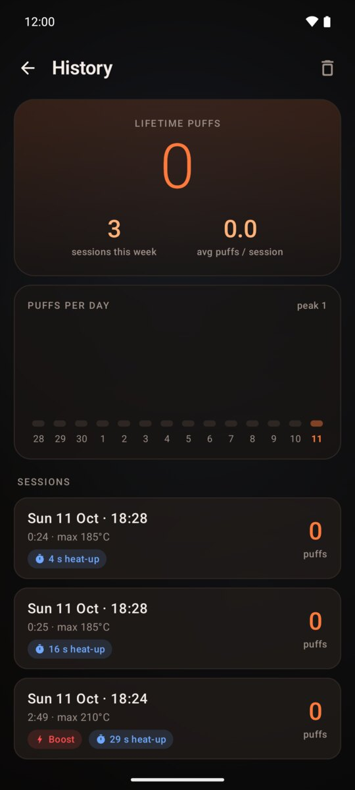
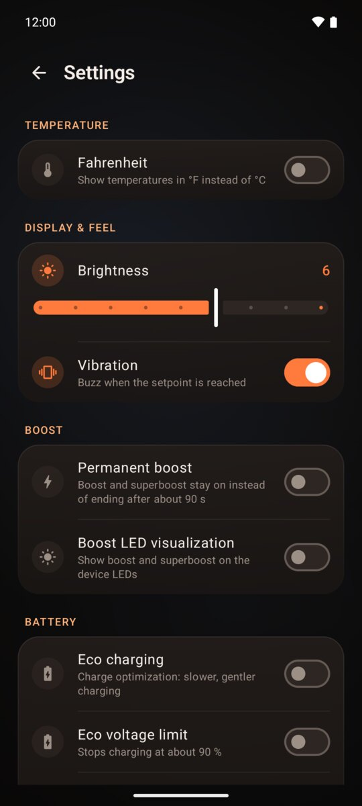

<p align="center">
  
</p>

<p align="center">
  
  
  
  
  <a href="LICENSE"></a>
</p>

<p align="center">
  <b>The Storz &amp; Bickel app is a Web Bluetooth page. This is a real one.</b><br>
  Kotlin, Jetpack Compose, a proper BLE stack, and an unreasonable amount of fire.
</p>

---

## Screenshots

All captured in the built-in demo mode, no device needed.

### Venty

<table>
  <tr>
    <td align="center" width="25%"><br><sub>Heating up</sub></td>
    <td align="center" width="25%"><br><sub>Ready at temperature</sub></td>
    <td align="center" width="25%"><br><sub>Superboost</sub></td>
    <td align="center" width="25%"><br><sub>Boost modes and offsets</sub></td>
  </tr>
</table>

### Volcano Hybrid

<table>
  <tr>
    <td align="center" width="33%"><br><sub>Heating with a live temperature</sub></td>
    <td align="center" width="33%"><br><sub>Ready</sub></td>
    <td align="center" width="33%"><br><sub>Filling the balloon</sub></td>
  </tr>
</table>

### Sessions and settings

<table>
  <tr>
    <td align="center" width="33%"><br><sub>Session done, cooling down</sub></td>
    <td align="center" width="33%"><br><sub>History</sub></td>
    <td align="center" width="33%"><br><sub>Settings</sub></td>
  </tr>
</table>

## Features

**Devices**

- 🔥 **Venty**: target temperature, heater on/off, Boost and Superboost with their own offsets, battery and charging state
- 🌋 **Volcano Hybrid**: live temperature on a 40–230 °C dial and a pump button that streams air into the balloon
- 🧪 **Demo mode** for both, so you can poke at everything without a device in hand

**Control**

- Big draggable temperature dial with magnetic presets
- Normal / Boost / Super selector that shows where each mode will land
- Find my device, °C / °F, brightness, vibration, eco charging and boost timeout
- Auto-reconnect with backoff, and a foreground service that keeps the link alive in the background

**Sessions**

- Puff detection and a session tracker, with a session-done card and cool-down ring
- History with growing chart bars and battery stats
- "At temperature" notification, a rich ongoing notification and a home-screen widget

**Flair**

- An ignition splash, rising embers, a rotating corona that speeds up in boost and a lava effect for Superboost
- A heat shockwave and ready flash when you hit temperature, slot-machine digits, a liquid charging fill
- A scan radar with signal bars, glassy cards, predictive back and Material You wallpaper colours
- Respects the system "remove animations" setting

## Install

There's no Play Store listing. Build it yourself:

```sh
git clone https://github.com/orth4x0r/venty-android
cd venty-android
./gradlew assembleRelease   # or open the folder in Android Studio
```

The APK lands in `app/build/outputs/apk/release/app-release.apk`. It's signed with a debug key, so allow installs from unknown sources. You need the Android SDK (Android Studio bundles it).

## How it talks to the device

The Venty speaks a small packet protocol over a single BLE characteristic, and the app polls it every 500 ms. The Volcano Hybrid exposes one characteristic per value instead, so `VolcanoLink` translates the Venty packets into Volcano reads and writes and everything above it (sessions, notification, widget) works unchanged. The full protocol, including what's been confirmed on real hardware, is in [docs/PROTOCOL.md](docs/PROTOCOL.md).

Tested on a real Venty: boost and superboost work, temperatures cap at 210 °C, and the Venty reports no live temperature (the app shows the target and whether it's still heating).

<details>
<summary><b>Code map</b></summary>

- `ble/VentyProtocol.kt`: packet encoding and decoding, unit tested in `app/src/test`
- `ble/GattLink.kt`: the BLE connection with a serial GATT operation queue
- `ble/VolcanoProtocol.kt`, `ble/VolcanoLink.kt`, `ble/GattVolcanoLink.kt`: Volcano Hybrid support
- `ble/DemoLink.kt`, `ble/DemoVolcanoLink.kt`: simulated devices speaking the same packets
- `ble/DeviceKind.kt`: what each device can do, which decides what the UI shows
- `ble/VentyController.kt`: scanning, the 500 ms poll, reconnect with backoff, commands
- `session/`: puff detection and session tracking
- `service/`, `widget/`: the foreground service, notification and home-screen widget
- `ui/`: Compose screens (connect, dashboard and dial, history, settings) and the effects

</details>

## Not supported

The Mighty+ has no Bluetooth, so it can't be supported. Other Storz &amp; Bickel devices (Crafty+, Veazy) aren't implemented.

## Credits

Protocol details come from the official web app's JavaScript and from [szv99/storz-bickel-ble](https://github.com/szv99/storz-bickel-ble), [lorek123/snb-ble](https://github.com/lorek123/snb-ble) and [firsttris/reactive-volcano-app](https://github.com/firsttris/reactive-volcano-app) (ideas and protocol notes only, no code).

## License

[MIT](LICENSE). Not affiliated with or endorsed by Storz &amp; Bickel. Venty and Volcano Hybrid are their trademarks. Use at your own risk; it's your hardware.
